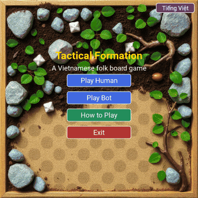
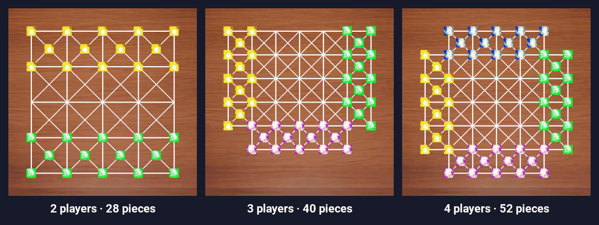

# Tactical Formation — The Board Game

[](https://github.com/GLOMQuyet/Tactical-Formation-The-Board-Game/actions/workflows/tests.yml)
[](https://doi.org/10.5281/zenodo.23437471)
[](https://github.com/GLOMQuyet/Tactical-Formation-The-Board-Game/releases/latest)
[](https://glomquyet.github.io/Tactical-Formation-The-Board-Game/)

<p align="center">
  
  <br>
  <em>A real game recorded from the game screen: select a piece, jump, and flip every enemy piece you sandwich.</em>
</p>

A board game for 2, 3 or 4 players. Every move is a jump over a neighbouring
piece; land so that enemy pieces sit in a straight line between your pieces
and the whole line changes to your colour. Nothing is ever removed: captured
pieces change colour, and a side that can no longer move is out. The last side
left wins. Play on one computer with friends, or against bots at three levels
of difficulty, in English or Vietnamese.

> **Origin.** Tactical Formation is the English name for **Cờ Trận**, a Vietnamese folk board game whose inventor and place of origin are unknown. Pieces were whatever could be found by the roadside: stones, pebbles, twigs, leaves. This project did not invent the game. It records the rules from memory and brings the game to software so that it is not forgotten.

> Full game rules and strategy guide: [study.md](./study.md)

---

## Quick Start

### Play in your browser

**https://glomquyet.github.io/Tactical-Formation-The-Board-Game/** (also on
[itch.io](https://glomquyets.itch.io/co-tran))

Nothing to install: it runs on phones, tablets and computers, in English or
Vietnamese, with the same game modes, bots and look as the download below.
Games are saved in the browser, so you can close the page and continue later.

### Download (no Python needed)

Ready-to-run copies are on the
[latest release](https://github.com/GLOMQuyet/Tactical-Formation-The-Board-Game/releases/latest),
one file per system, nothing to unzip:

| System | File |
|---|---|
| Windows | `TacticalFormation-Windows-amd64.exe` |
| macOS (Apple Silicon) | `TacticalFormation-macOS-arm64.dmg` |
| Linux (Ubuntu and others) | `TacticalFormation-Linux-x86_64` |

The copies are not signed, so the first start asks you to confirm:

- **Windows:** double-click the `.exe`; at "Windows protected your PC" →
  *More info* → *Run anyway*.
- **macOS:** open the `.dmg` and drag *TacticalFormation* to *Applications*.
  Then right-click the app → *Open*; on macOS 15, open it once, then
  *System Settings* → *Privacy & Security* → *Open Anyway*.
- **Linux:** a downloaded file is not yet allowed to run, so first run
  `chmod +x TacticalFormation-Linux-x86_64`, then `./TacticalFormation-Linux-x86_64`
  (or in Files: right-click → *Properties* → *Executable as Program*).

To run from the source code instead:

### Requirements

- [uv](https://docs.astral.sh/uv/getting-started/installation/). uv installs the
  right Python (3.12, from `.python-version`) and the locked dependencies
  (`uv.lock`) by itself; no manual virtual environment or `pip` is needed.

```bash
# Linux / macOS
curl -LsSf https://astral.sh/uv/install.sh | sh
```

```powershell
# Windows (PowerShell)
powershell -ExecutionPolicy ByPass -c "irm https://astral.sh/uv/install.ps1 | iex"
```

### Install and run

```bash
git clone https://github.com/GLOMQuyet/Tactical-Formation-The-Board-Game.git
cd Tactical-Formation-The-Board-Game
uv run main.py
```

The first `uv run` creates `.venv/` and installs pygame from the lock file; later
runs start immediately. An 800×800 window opens with the main menu.

### Tests

```bash
uv run python -m unittest discover -s tests
```

GitHub Actions runs the same tests on Linux, Windows and macOS for every push,
including the menus and the game screen (headless). The tests for the browser
version (`tests/test_web.py`) need [Node.js](https://nodejs.org) and are skipped
without it.

### Ready-to-run copy (no Python needed)

```bash
uv run tools/build_app.py
```

This makes one file in `dist/` for the system it runs on: a `.exe` on
Windows, a `.dmg` disk image holding the app on macOS, a program on Linux.
The `build` workflow does the same on GitHub for all three systems (run it from
the Actions tab to get the files as run artifacts); pushing a version tag (for
example `v1.1.0`) publishes them on a GitHub release.

---

## Game Modes

<p align="center">
  
</p>

| Menu | Choice | Description |
|---|---|---|
| **Play Human** | 2, 3 or 4 Players | Everyone plays on the same machine, taking turns with the mouse |
| **Play Bot** | 1 vs Bot (2P) | You (Green) vs a Minimax bot (Yellow) |
| | 1 vs 2 Bots (3P) | You (Green) vs 2 Paranoid Minimax bots (Purple, Yellow) |
| | 1 vs 3 Bots (4P) | You (Green) vs 3 Paranoid Minimax bots (Blue, Purple, Yellow) |
| **Continue** | | Shown when a game is unfinished; resumes it |

The menus and the game are in English or Vietnamese: the button in the top
right corner of the main menu switches, and the choice is remembered. On the
first run the language follows the computer's language setting.

After choosing a bot game you pick a difficulty. It sets how many moves ahead
the bots search:

| Difficulty | 2 players | 3 players | 4 players |
|---|---|---|---|
| Easy | 2 | 2 | 1 |
| Medium | 4 | 3 | 2 |
| Hard | 6 | 4 | 3 |

Hard is the setting measured in the paper. Bots think in a separate process,
so the window stays responsive while they search.

**During a game.** The bar at the top left shows whose turn it is, and the
strip at the bottom how many pieces each side has (sides that are out are
struck through). The last move is marked on the board: a small ring where it
started, an orange ring where it landed, and white rings on the pieces it
flipped. Bots wait a moment before moving so you can follow them. **Menu** (top right) leaves the game; in
the 2-player bot game the undo button next to it takes back your last move
and the bot's reply. If you are knocked out of a bot game, you can watch the
bots finish, start a new game, or go back to the menu. When the game ends,
the final position stays on screen under the result.

**Window and keys.** The window fits the screen (on a 1366×768 laptop it opens
smaller) and can be resized; the board scales with it.

| Key | Action |
|---|---|
| F11 | Full screen on/off |
| Esc | Leave the game (it stays saved) or go back one menu |
| Ctrl+Z or Backspace | Undo, in the 2-player bot game |
| ← → | Turn the pages of How to Play |

**Autosave.** The game is saved after each of your moves (and every few
seconds while only bots move) and the save is removed when the game ends, so
you can leave at any time and pick the game up again with **Continue**.
Starting a new game asks first if it would replace a saved one. The save file
is `autosave.json` in `%APPDATA%\TacticalFormation` (Windows),
`~/Library/Application Support/TacticalFormation` (macOS) or
`~/.local/share/tactical-formation` (Linux); the language choice is kept
next to it in `settings.json`.

---

## The browser version

[`web/`](web/) is the game for web browsers, written in React and TypeScript and
built with [Vite](https://vite.dev). It uses the desktop game's pictures, font
and colours, and the same screens: menus, How to Play, the board, the result
panel.

The rules and the bots are a second implementation in JavaScript
([`web/src/engine/`](web/src/engine/)), written so that the game also runs on
phones. To keep the two the same, `tests/test_web.py` plays random games with
the Python engine and replays them in the JavaScript one with Node.js: at every
turn both must give the same list of moves, the same position, the same turn
and the same winner, and at sampled turns the two bots must find the same best
moves. The `web` workflow runs this check, builds the app and publishes it on
GitHub Pages.

To work on it ([Node.js](https://nodejs.org) 20.19 or later):

```bash
cd web
npm install
npm run dev      # a local server that reloads on every change
npm run build    # type check, then the finished site in web/dist/
```

---

## Play in Ludii

[`docs/ludii/Tactical Formation.lud`](docs/ludii/Tactical%20Formation.lud) describes the
game for [Ludii](https://ludii.games), the general game system with a large library
of traditional games (2, 3 or 4 players under *Options → Players*). Load it with
*File → Load Game from File*. After a jump, if lines are sandwiched, click your own
piece at the far end of the line you want to flip.

The file is generated from `core/modes.py` by `tools/make_ludii.py` and checked
against this game's rules: 55 random games played to the end in Ludii 1.3.14
(about 119,000 decisions) matched move for move, including the winners. Ludii stops any game
after 1,250 turns and scores it as a draw; the folk game itself has no move limit.

---

## How to Play (Quick Rules)

1. **Move** — click a piece, then click a highlighted dot to jump over an adjacent piece
2. **Capture** — after landing, any opponent pieces sandwiched between your pieces flip to your color
3. **Win** — eliminate all opponent pieces or leave them with no legal moves

See [study.md](./study.md) for the full rulebook, board diagrams, and strategy tips.

---

## Project Structure

```
Tactical-Formation-The-Board-Game/
├── main.py                 # Entry point: starts pygame and switches screens
├── pyproject.toml          # Project metadata and dependencies (uv)
├── uv.lock                 # Locked dependency versions
├── study.md                # Full rulebook & guide
├── core/
│   ├── board.py, piece.py, rules.py, state.py   # Rule engine
│   ├── modes.py            # The game variants and the bot difficulty levels
│   ├── history.py          # Move records for undo and saves
│   └── savegame.py         # Autosave and resume
├── ai/
│   ├── minimax.py          # 2-player bot: Minimax with Alpha-Beta
│   ├── paranoid.py         # 3/4-player bots: Paranoid Minimax
│   ├── policy.py           # Picks the engine for the current mode
│   └── worker.py           # Runs the search in a separate process
├── ui/
│   ├── screens/            # menu.py, howto.py (How to Play), game.py
│   ├── display.py          # The window: scaling, full screen, mouse positions
│   └── ...                 # Rendering, input, animation, widgets, theme, i18n (text)
├── web/                    # The browser version (React + TypeScript): src/engine/ (rules, bots), src/components/
├── experiments/            # Headless measurements behind the paper (results/)
├── tests/                  # Rules, bots, autosave, interface text and screens, browser version
├── tools/make_figures.py   # Renders the board figures used in the paper
├── tools/build_app.py      # Builds a ready-to-run copy with PyInstaller
├── tools/make_ludii.py     # Writes the Ludii version (docs/ludii/)
├── docs/                   # Formal model of the 2-player game
├── assets/                 # Images and fonts
└── .github/workflows/      # Tests on every push; builds releases; publishes web/ on GitHub Pages
```

The bots use Minimax-family search only; Monte Carlo Tree Search is not used
(Appendix C of the [paper](https://doi.org/10.5281/zenodo.23437471) explains why).

---

## How to Cite

If you write about the game or use the software, please cite the paper
(author: Truong Van Quyet, ORCID [0009-0001-8117-922X](https://orcid.org/0009-0001-8117-922X)):

> Truong, V. Q. (2026). *Tactical Formation: Documenting and Analysing a
> Vietnamese Folk Board Game for 2–4 Players* [Preprint]. Zenodo.
> https://doi.org/10.5281/zenodo.23437471

```bibtex
@misc{truong2026tactical,
  author    = {Truong, Van Quyet},
  title     = {Tactical Formation: Documenting and Analysing a Vietnamese Folk Board Game for 2--4 Players},
  year      = {2026},
  publisher = {Zenodo},
  doi       = {10.5281/zenodo.23437471},
  note      = {Preprint}
}
```

GitHub's *Cite this repository* button (from `CITATION.cff`) gives both the
paper and the software reference.

---

## License

- Software: [MIT](./LICENSE).
- Paper ([doi:10.5281/zenodo.23437471](https://doi.org/10.5281/zenodo.23437471)): [CC BY 4.0](https://creativecommons.org/licenses/by/4.0/).
- The rules of Cờ Trận are a Vietnamese folk tradition and are not owned by the author.

---

## Troubleshooting

| Error | Fix |
|---|---|
| `ModuleNotFoundError: pygame` | Start the game with `uv run main.py`, not with the system `python` |
| `ImportError` on startup | Run from the project root directory (where `main.py` lives) |
| Black screen on Linux | Try `export SDL_VIDEODRIVER=x11` before running |
